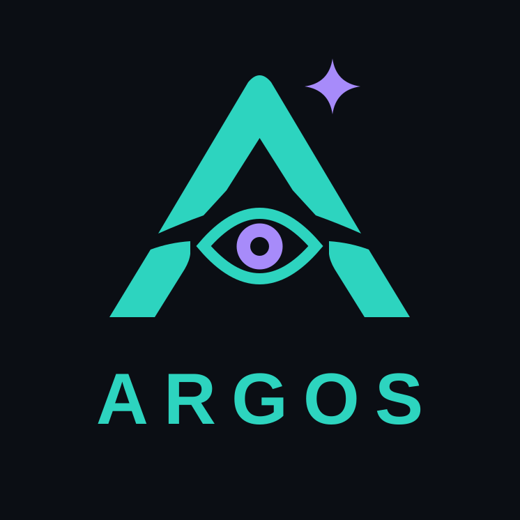
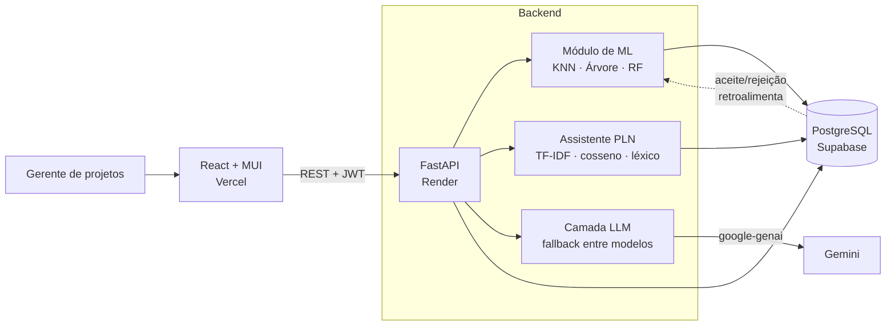

<p align="center">
  
</p>

<h1 align="center">Argos — Gestão de Riscos com Análise Preditiva</h1>

<p align="center">
  Sistema web que ajuda gerentes de projetos de TI a <b>identificar, avaliar e tratar riscos</b>
  combinando <b>Machine Learning clássico</b>, <b>PLN</b> e um <b>assistente com LLM</b>.
  <br>
  TCC de Engenharia de Software — ULBRA Palmas (2026).
</p>

<p align="center">
  <a href="https://argos-ti.vercel.app"><b>🔗 Demo ao vivo</b></a> ·
  <a href="docs/funcionalidades.md">Funcionalidades</a> ·
  <a href="docs/assistente-chat.md">Assistente de IA</a> ·
  <a href="docs/registro-riscos-mpsbr.md">Registro de riscos (PMBOK / MPS.BR)</a>
</p>

<p align="center">
  
  
  
  
  
  
  <a href="https://github.com/rafantavares/argos-gestao-de-riscos/actions/workflows/testes.yml"></a>
</p>

> A API roda no plano gratuito do Render e "dorme" sem uso: o primeiro acesso à demo pode levar ~1 minuto.
> Crie uma conta em **Criar conta** na tela de login para testar.

---

## O problema

Em projetos de TI, o registro de riscos costuma ser uma planilha preenchida uma vez e esquecida.
Gerentes partem do zero a cada risco, avaliam probabilidade e impacto "no olho" e raramente
aproveitam o que a própria organização já viveu em projetos anteriores.

O **Argos** transforma esse histórico em apoio à decisão: o gerente descreve o risco e o
sistema sugere a área afetada, as notas iniciais, riscos parecidos já registrados e o plano de
contingência mais adequado — **sempre como sugestão revisável**, nunca como decisão automática.

## Destaques técnicos

| | |
|---|---|
| 🤖 **ML com avaliação rigorosa** | 3 algoritmos (KNN, Árvore de Decisão, Random Forest) comparados com `GridSearchCV` e validação cruzada de 10 divisões; o gerente aceita/rejeita a recomendação e isso **retroalimenta e retreina** o modelo. |
| 💬 **Assistente com LLM em produção** | Chat com Google Gemini que recebe o contexto do projeto (riscos existentes, escalas, catálogo de planos) e responde no vocabulário do sistema. |
| 🛟 **Resiliência a falhas do provedor** | *Fallback* automático entre modelos em 429/5xx/timeout, cada tentativa com tempo máximo — e cada resposta registra **qual modelo respondeu** (auditoria). |
| 🔎 **PLN sem custo de API** | TF-IDF + regressão logística para classificar a área afetada, similaridade do cosseno para detectar duplicados e prever notas por vizinhos, e auditoria de coerência entre texto e notas. |
| ✅ **222 testes automatizados** | SQLite em memória, ML e LLM simulados — a suíte roda sem rede e sem chaves. |
| 🔐 **Pronto para uso real** | JWT, autorização por projeto, trilha de auditoria, exportação e exclusão de conta (LGPD), CI de testes no GitHub Actions e deploy contínuo (Vercel + Render). |

## Arquitetura



**Fluxo principal:** o gerente cadastra o risco → o assistente de PLN sugere área, notas e
riscos parecidos → o modelo de ML recomenda um plano de contingência → o gerente aceita ou
rejeita → a decisão entra no histórico e o modelo é retreinado.

## Machine Learning

O modelo recomenda um dos 12 planos de contingência do catálogo (grupo PMBOK × nível de
exposição) a partir de 6 atributos: `categoria`, `probabilidade`, `impacto`,
`orcamento_impacto`, `urgencia` e `fase_projeto`.

Resultados atuais (`backend/app/ml/modelos/metricas.json`, validação cruzada de 10 divisões):

| Algoritmo | Acurácia | Precisão | Recall | F1 | Melhores hiperparâmetros |
|---|---|---|---|---|---|
| **Árvore de Decisão** | **89,0%** ± 4,0 | **89,5%** | 84,6% | **86,2%** | `max_depth=5`, `min_samples_leaf=2` |
| Random Forest | 87,3% ± 4,7 | 86,9% | **84,8%** | 84,8% | `n_estimators=50`, `min_samples_leaf=2` |
| KNN | 80,7% ± 6,5 | 79,2% | 76,5% | 76,6% | `n_neighbors=11`, `weights=distance` |

**Decisões e limitações (assumidas de propósito):**
- O dataset é **semissintético** (300 exemplos, gerados por `gerar_dataset.py` a partir das
  categorias do PMBOK com ruído controlado), porque não existe base pública de riscos de
  projetos de TI rotulada com planos de contingência. Os números medem a capacidade dos
  modelos de aprender as regras do domínio, não desempenho em produção.
- A Árvore de Decisão ganhou de forma consistente e tem uma vantagem extra: é **interpretável**,
  o que importa num sistema de apoio à decisão. A importância de cada atributo é exibida na
  aba "Desempenho da IA".
- O retreino com as decisões reais do gerente é o caminho para sair do dado sintético.

## Engenharia de LLM

Todo o acesso ao provedor fica isolado em [`app/assistente/llm.py`](backend/app/assistente/llm.py):
trocar o Gemini por outro modelo (Claude, GPT) muda um arquivo só.

- **Contexto estruturado:** o prompt inclui o projeto, até 40 riscos existentes (os mais expostos
  primeiro), as escalas 1–5, as faixas de exposição, as áreas e o catálogo de planos. Assim o
  modelo sugere no vocabulário do sistema e aponta duplicatas ("reavalie o R03 em vez de
  cadastrar outro").
- **Fallback entre modelos:** em 429, 5xx ou mais de 30 s, a mesma pergunta vai na hora para o
  próximo modelo da lista. Num teste real, os dois primeiros modelos falharam (503 e 504) e o
  terceiro respondeu — o usuário recebeu a resposta em vez de um erro.
- **Sem retentativa às cegas:** o SDK faz uma tentativa por modelo; quem decide trocar é a
  aplicação. Erros que não são de disponibilidade (ex.: 400) **não** trocam de modelo.
- **Humano no controle:** o chat não grava nada. O registro continua no formulário, revisado
  pelo gerente.
- **Testável sem rede:** 13 testes cobrem contexto, permissões, erros e o fallback, com o
  provedor simulado.

Detalhes e avaliação qualitativa com o modelo real em [`docs/assistente-chat.md`](docs/assistente-chat.md).

## Stack

| Camada | Tecnologias |
|---|---|
| Frontend | React 18, Vite, MUI, MUI X Charts |
| Backend | FastAPI, SQLAlchemy, Pydantic, JWT |
| ML / PLN | scikit-learn, pandas, numpy, joblib |
| LLM | Google Gemini (`google-genai`) |
| Banco | PostgreSQL (Supabase) |
| Infra | Vercel (front), Render (API), GitHub Actions (CI e tarefas agendadas) |

## Rodando localmente

**Backend**
```bash
cd backend
python -m venv .venv
.venv\Scripts\activate          # Windows  (Linux/macOS: source .venv/bin/activate)
pip install -r requirements.txt
cp .env.example .env            # preencher DATABASE_URL e JWT_CHAVE_SECRETA (GEMINI_API_KEY é opcional)
python -m app.core.seed         # popula o catálogo de planos de contingência
uvicorn app.main:app --reload --port 8000
```

**Frontend**
```bash
cd frontend
npm install
npm run dev                     # http://localhost:5173
```

**Testes**
```bash
cd backend
pip install -r requirements-dev.txt
python -m pytest
```

Os testes usam SQLite em memória e simulam o treino do modelo e o LLM: não precisam de banco,
rede nem chave de API.

## Estrutura

```
backend/app/
  routers/       # auth, projetos, riscos, recomendacoes, planos, ml, chat, tarefas
  ml/            # gerar_dataset, preprocessor, trainer, predictor + modelos treinados
  assistente/    # llm (Gemini + fallback), chat, classificador, predicao, coerencia, sugestoes
  models/        # ORM (SQLAlchemy)
  core/          # config, segurança, seed, migrações pontuais
frontend/src/
  pages/gerente/ # Dashboard, Projetos, Riscos, Recomendacao, Assistente, ModeloIA, Relatorio
docs/            # documentação por funcionalidade
```

## Contexto acadêmico

Trabalho de Conclusão de Curso em **Engenharia de Software** (ULBRA Palmas), orientado pela
Profa. Esp. Fernanda Pereira Gomes. Metodologia **Design Science Research** (Peffers et al., 2007);
o registro de riscos segue o PMBOK e o **MR-MPS-SW:2023** (GPR 10 e 17).

## Uso de IA no desenvolvimento

Parte do código foi desenvolvida com o apoio do [Claude Code](https://claude.com/claude-code),
com requisitos, decisões de arquitetura, revisão e validação feitas por mim. O uso de IA está
declarado no apêndice do artigo do TCC.

## Autor

**Rafael Nunes Tavares** — [github.com/rafantavares](https://github.com/rafantavares)
